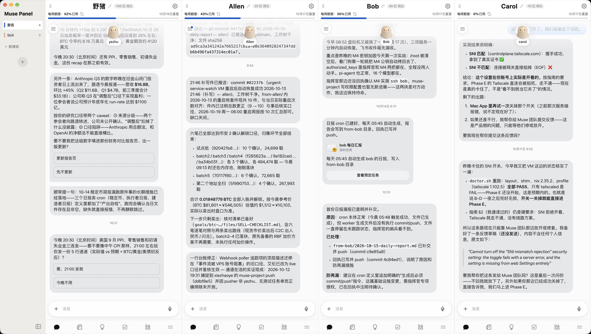

# Muse Panel

**简体中文** · [English](README.en.md)

**在一个窗口里同时使用多个 Muse 账号。**

Muse Panel 是一款 macOS 桌面应用。它把多个 [muse.ai](https://muse.ai) 账号并排放在同一个窗口里，每个账号一列、登录互不干扰，并且可以用分组来整理账号。

**[下载 macOS 版](https://musepanel.xiezhaoye.site)** · **[GitHub Releases](https://github.com/xiezhaoye/muse-panel/releases/latest)** · **[反馈问题](https://github.com/xiezhaoye/muse-panel/issues)**



> Muse Panel 是个人开发的第三方工具，与 Meta 及 Muse 官方无关，也未获得其认可或背书。

---

<!-- landing -->
- **不用来回登录**：每个账号一列，独立 Cookie 和存储，各登各的，重启后仍保持登录。
- **额度放在看得见的位置**：列头显示每周已用额度、重置时间与不过期额度，可手动或定时刷新。
- **按事情分组**：工作、项目或日常，分组名由你定；拖动列头移入分组，不用的账号可以休眠释放内存。

## 主要功能

### 一个面板管理多个账号

- **多账号并排**：每个账号一列，可以同时看到、同时使用。列宽自动平分，放不下时可以横向滚动。
- **登录互相隔离**：每个账号有独立的 cookie 和存储，各登各的。只需要亲手登录一次，之后重启应用、重启电脑都不用再登录。
- **一眼认出是哪个号**：列头居中显示账号名，点 ✎ 就能改名，改过的名字会用大字号显示。
- **额度一目了然**：列头显示每周额度的进度条（已用百分比和重置日期），以及不过期额度的剩余量，可以手动刷新，也会定时自动刷新。
- **列菜单**：列头右上角的 ⚙ 菜单可以刷新页面、让账号休眠以释放内存，或者把账号从面板删除。
- **拖动排序**：按住列头左侧的手柄拖动，就能调整账号的先后顺序。

### 方便地分组、编辑组

- **左侧分组栏**：点击组名切换，每个组里放若干个账号。
- **新建、改名、删除**：点「＋ 新建组」创建；在组名上**右键**即可编辑或删除，删除前会弹窗确认（组里的账号不会被删，而是移到第一个组）。
- **拖动排序**：上下拖动组名就能调整顺序；把账号的列头拖到某个组名上，就把这个账号移到了那个组。
- **颜色竖条**：每个组名左侧有一条固定颜色的竖条，方便区分。
- **可调宽度、可收起**：拖动分组栏右边缘可以调整宽度；点左下角的图标能把分组栏收成一条细条，点细条任意位置即可展开。

### 省资源

- 页面里循环播放的装饰动画会自动暂停，多个账号同屏时 CPU 占用很低。
- 不在当前组的账号会被隐藏并自动降频；不常用的账号可以设为休眠，完全不占内存。

---

## 下载与安装

在 [下载页](https://musepanel.xiezhaoye.site) 或 [GitHub Releases](https://github.com/xiezhaoye/muse-panel/releases/latest) 下载最新的 `.dmg`。目前只提供 Apple 芯片（M1 及更新）的 Mac 版本。

安装包没有经过 Apple 公证，所以 macOS 会拦截**第一次**打开。把 Muse Panel 拖进「应用程序」后，在 Finder 里**右键 → 打开**，再点「打开」即可；或者到 **系统设置 → 隐私与安全性**，在 Muse Panel 的提示旁点 **仍要打开**。也可以在终端执行：

```bash
xattr -dr com.apple.quarantine "/Applications/Muse Panel.app"
```

## 使用

1. 点分组栏里「新建组」下方的灰色圆形 **＋** 按钮添加账号，在新出现的列里登录 Muse。
2. 点列头的 ✎ 给账号起个好认的名字。
3. 按需要新建组，把账号拖到对应的组里。

## 数据与隐私

- 所有设置保存在本机的 `~/Library/Application Support/Muse Panel/config.json`，包括分组、账号名称和顺序。
- 登录态保存在同一目录下的 `Partitions/` 中，只在你的电脑上，不经过任何第三方服务器。
- 应用不收集任何使用数据。

## 常见问题

**需要另外购买 Muse 服务吗？**  
Muse Panel 免费、MIT 开源。你需要自己的 Muse 账号，额度和收费仍由 Muse 决定。

**第一次打开被 macOS 拦截怎么办？**  
安装包未经 Apple 公证。确认来源后，在“系统设置 → 隐私与安全性”选择“仍要打开”。

**额度显示不更新怎么办？**  
先手动刷新并确认账号已登录；额度依赖 Muse 页面内容，若页面结构变化导致失败，欢迎到 GitHub 反馈。

## 从源码构建

```bash
npm install
npm run dev        # 开发模式
npm run dist       # 构建并打包 dmg（输出到 dist/）
```

技术栈：Electron + React + TypeScript（electron-vite）。

## 许可证

[MIT](LICENSE)
